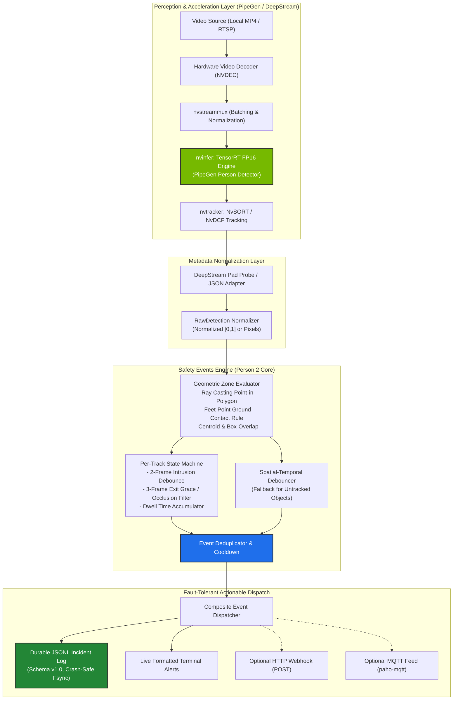

# Workplace Safety Sentinel — System Architecture

## 1. High-Level Overview

Workplace Safety Sentinel is a high-performance vision-AI edge analytics system designed for industrial worker safety. It detects personnel entering hazardous industrial perimeters (e.g., robotic cells, heavy machinery danger envelopes) and transforms raw perceptual detections into structured, deduplicated, and actionable incident records.

The system is built on **CraftifAI PipeGen v0.5.1**, compiled to **TensorRT FP16**, executed via **NVIDIA DeepStream**, and processed through a deterministic, debounced safety logic engine.

---

## 2. PipeGen Five-Stage Pipeline Flow

| Stage | Name | Implementation & Artifact | Description |
|---|---|---|---|
| **1** | **Requirement** | `pipegen-export/requirement.yaml` | Declares domain, latency target ($\le 33\text{ ms}$), target hardware, and person detection scope. |
| **2** | **Pipeline IR** | `pipegen-export/pipeline_ir.json` | Computational DAG linking video decoding, inference, tracking, and metadata extraction. |
| **3** | **Model Selection** | `pipegen-export/model_config.json` | High-precision CSPDarknet/YOLO person detector catalog model ($640\times 640$). |
| **4** | **Compiler** | `pipegen-export/speed_report.json` | TensorRT compilation to FP16 precision. Achieved 9.8 ms latency ($4.29\times$ speedup). |
| **5** | **Run** | `run_sentinel.py` | Live deployment on local video stream with continuous safety metadata parsing. |

---

## 3. Per-Track State Transition Lifecycle

To eliminate false positives from single-frame detector jitter and prevent alert fatigue, the safety engine maintains an explicit state machine for each track:

```mermaid
stateDiagram-v2
    [*] --> OUTSIDE
    OUTSIDE --> ENTERING: Frame inside zone (count = 1)
    ENTERING --> OUTSIDE: Frame outside zone (flicker noise suppressed)
    ENTERING --> IN_ZONE: 2nd consecutive frame inside\n[EMIT ZONE_INTRUSION]
    
    IN_ZONE --> IN_ZONE: Remains inside\n(Repeated alerts suppressed;\ncooldown active)
    
    IN_ZONE --> EXITING: Frame outside/occluded (grace count = 1)
    EXITING --> IN_ZONE: Re-detected inside within grace period\n(Temporary occlusion handled)
    EXITING --> CLEARED: 3 consecutive frames outside\n[EMIT ZONE_CLEAR with dwell_time]
    CLEARED --> [*]
```

---

## 4. Fault Isolation Guarantee

- **Primary Sink:** `JsonlDispatcher` writes to local append-only `.jsonl` with atomic flush and schema validation.
- **Secondary Sinks:** `WebhookDispatcher` and `MqttDispatcher` run within guarded exception blocks with strict timeouts.
- **Reliability Invariant:** If the MQTT broker drops offline or the HTTP webhook fails, **the incident log is never interrupted or blocked**.
