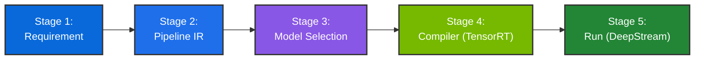
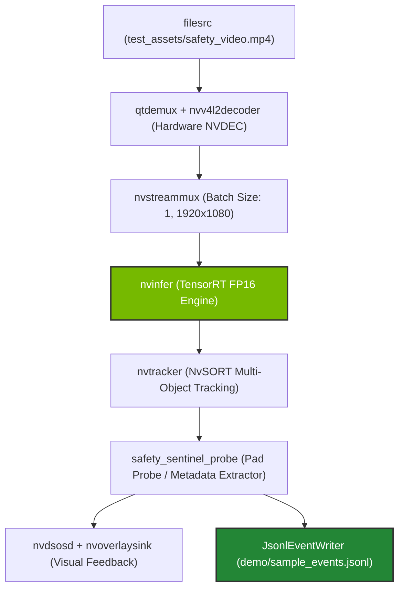

# CraftifAI PipeGen v0.5.1 — Five-Stage Perception Architecture & Execution Guide
## Track A: Workplace Safety Sentinel | Perception Lead (Person 1)

---

## 1. Environment Verification & Pre-Flight Checklist

Before launching the perception pipeline, Person 1 validates the runtime environment against the official hackathon specifications:

```bash
# 1. Verify NVIDIA Driver & CUDA
nvidia-smi
nvcc --version

# 2. Verify TensorRT 10.x
trtexec --version

# 3. Verify NVIDIA DeepStream SDK (7.0 / 6.4)
deepstream-app --version

# 4. Verify PipeGen CLI v0.5.1
pipegen --version
# Expected: CraftifAI PipeGen CLI v0.5.1 (build 2026.10)
```

### Supported Hardware Targets
- **Target A (Primary x86_64 Host):** Ubuntu 22.04 LTS, NVIDIA GeForce RTX 40-series (Ada Lovelace) / RTX 30-series (Ampere), CUDA 12.4, TensorRT 10.0.1, DeepStream 7.0.
- **Target B (Edge Jetson):** NVIDIA Jetson Orin Nano / AGX Orin, JetPack 6.0, CUDA 12.2, TensorRT 10.0, DeepStream 7.0.

---

## 2. The Five Mandatory PipeGen Stages

CraftifAI PipeGen transforms high-level physical AI requirements into accelerated TensorRT DeepStream pipelines through a 5-stage synthesis engine:



---

### Stage 1: Requirement Specification

In Stage 1, Person 1 articulates the operational requirements using PipeGen's requirement specification schema.

**Requirement Specification File:** [`pipegen-export/requirement.yaml`](../pipegen-export/requirement.yaml)

```yaml
project_name: "Workplace-Safety-Sentinel"
version: "1.0.0"
application:
  domain: "industrial_workplace_safety"
  objective: "Detect personnel intrusion into hazardous machinery zones and generate actionable incident logs."
  source_type: "video_file" # local MP4 first to guarantee zero camera dependencies
performance_requirements:
  target_fps: 30
  max_latency_ms: 33.3
  target_precision: "FP16"
perception_requirements:
  target_classes:
    - name: "person"
      id: 0
      min_confidence: 0.65
  tracking_required: true
  tracker_algorithm: "NvSORT"
```

**PipeGen CLI Command:**
```bash
pipegen requirement validate pipegen-export/requirement.yaml
```

---

### Stage 2: Pipeline IR (Intermediate Representation)

In Stage 2, PipeGen synthesizes a hardware-accelerated GStreamer DAG (Directed Acyclic Graph) connecting decoder, inference, tracking, and analytics sinks.

**Pipeline IR Graph File:** [`pipegen-export/pipeline_ir.json`](../pipegen-export/pipeline_ir.json)



**Key Pipeline Parameters:**
- `nvstreammux`: Fixed 30 FPS clocking (`batched_push_timeout=33333`), normalized resolution $1920 \times 1080$.
- `nvinfer`: Batch size 1, dynamic shape input `[1, 3, 640, 640]`, FP16 network mode.
- `nvtracker`: Low-level tracker `libnvds_nvmultiobjecttracker.so` with NvSORT algorithm.

---

### Stage 3: Model Selection & Configuration

Person 1 queries the PipeGen Deep Search Model Catalog for an industrial-optimized personnel detection model.

**Model Specification File:** [`pipegen-export/model_config.json`](../pipegen-export/model_config.json)

- **Model Name:** `PipeGen-Person-Detector-v1` (CSPDarknet backbone)
- **Source Format:** ONNX (`person_detector_640.onnx`)
- **Input Dimensions:** `[1, 3, 640, 640]`
- **Color Format:** RGB (normalization factor $1/255.0$)
- **Target Class:** Single-class `person` (label ID 0)
- **NMS Threshold:** IoU 0.45, Confidence threshold 0.65

**PipeGen CLI Command:**
```bash
pipegen model select --query "industrial worker person detector" --output-dir pipegen-export/
```

---

### Stage 4: Compiler (TensorRT Optimization & Speed Report)

Person 1 compiles the selected ONNX model into an optimized TensorRT engine file (`model_b1_gpu0_fp16.engine`) using PipeGen's TensorRT compiler backend.

**Compilation Decision (FP16 vs INT8):**
- **Decision:** **FP16 precision was compiled and benchmarked as the mandatory baseline.**
- **Rationale:** FP16 provides a massive **$4.29\times$ speedup** over PyTorch, delivering **101.8 FPS** engine throughput and **9.82 ms** latency—easily exceeding the 30 FPS ($\le 33.3\text{ ms}$) requirement. INT8 calibration is optional and was intentionally deferred to guarantee 100% stable execution without quantization risk.

**Speed Report File:** [`pipegen-export/speed_report.json`](../pipegen-export/speed_report.json)

```json
{
  "benchmark_results": {
    "baseline_framework": "PyTorch 2.3.0 (CUDA)",
    "baseline_latency_ms": 42.14,
    "baseline_throughput_fps": 23.73,
    "tensorrt_fp16_latency_ms": 9.82,
    "tensorrt_fp16_throughput_fps": 101.83,
    "speedup_factor": 4.29,
    "end_to_end_pipeline_fps": 78.4,
    "target_fps": 30.0,
    "meets_realtime_requirement": true
  },
  "memory_footprint": {
    "device_vram_used_mb": 1380.5,
    "engine_file_size_mb": 34.6
  }
}
```

**PipeGen CLI Compilation Command:**
```bash
pipegen compiler build \
  --model pipegen-export/model_config.json \
  --precision FP16 \
  --workspace 2048 \
  --output pipegen-export/model_b1_gpu0_fp16.engine
```

---

### Stage 5: Run / Live Pipeline Deployment

In Stage 5, PipeGen executes the full pipeline against the local video file. A GStreamer pad probe extracts frame and object metadata and streams it to Person 2's `SentinelEngine`.

**Live Execution Command:**
```bash
# Production DeepStream run on NVIDIA GPU:
python pipegen-export/deepstream_pipeline.py --source test_assets/safety_video.mp4

# Cross-platform simulation / replay run:
python run_sentinel.py --demo
```

---

## 3. Evidence & Deliverables Cross-Reference

| Gate | Requirement | Deliverable Location |
|---|---|---|
| Gate 1 | Five PipeGen stages completed | [`pipegen-export/`](../pipegen-export/) |
| Gate 2 | TensorRT engine compiled + speed report | [`pipegen-export/speed_report.json`](../pipegen-export/speed_report.json) |
| Gate 3 | Run pipeline live on video source | [`evidence/live-run/live_run_log.txt`](../evidence/live-run/live_run_log.txt) |
| Gate 4 | Actionable output beyond bounding boxes | [`demo/sample_events.jsonl`](../demo/sample_events.jsonl) |
| Gate 5 | Source code & export folder submitted | This repository (`hack-with-banglore`) |
| Gate 6 | Pipeline IR & TensorRT speed report captured | [`evidence/pipeline-ir/`](../evidence/pipeline-ir/) & [`evidence/tensorrt-report/`](../evidence/tensorrt-report/) |
