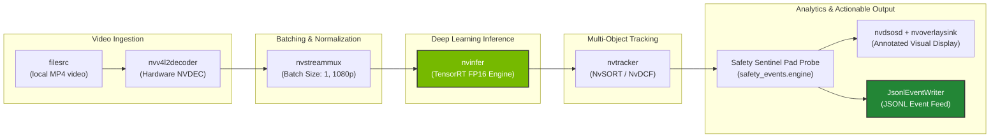

# Pipeline IR Graph Evidence
## PipeGen Stage 2 Verification

### Visual Graph Architecture
The Pipeline IR represents the declarative computation graph generated by CraftifAI PipeGen v0.5.1:

### Visual Render
Vector diagram generated by `scripts/render_pipeline_ir.py`:
- [pipeline_ir_rendered.svg](pipeline_ir_rendered.svg)

---

### Node-by-Node Pipeline IR Specification

| Node ID | Plugin / Component | Category | Inputs | Outputs | Key Configuration |
|---|---|---|---|---|---|
| `node_source` | `filesrc` | Input | None | `stream_raw` | `location: test_assets/safety_video.mp4` |
| `node_parser_decoder` | `qtdemux_h264parse_nvv4l2decoder` | Decoder | `stream_raw` | `video_nvmm` | Hardware NVDEC, GPU ID 0 |
| `node_streammux` | `nvstreammux` | Muxer | `video_nvmm` | `muxed_batch` | Batch: 1, 1920x1080, push timeout: 33333 us (30 FPS) |
| `node_nvinfer_tensorrt` | `nvinfer` | Inference | `muxed_batch` | `inference_meta` | FP16 TensorRT engine (`model_b1_gpu0_fp16.engine`) |
| `node_nvtracker` | `nvtracker` | Tracker | `inference_meta` | `tracked_meta` | NvSORT tracking (`config_tracker_NvSORT.yml`) |
| `node_safety_sentinel_probe` | `safety_events.engine` | Analytics | `tracked_meta` | `safety_meta` | Pad probe attaching to src pad, schema v1.0 |
| `node_osd_sink` | `nvdsosd_nvoverlaysink` | Sink | `safety_meta` | None | Real-time visual overlay & display sink |

### Source JSON Specification
See full JSON DAG definition in [`pipegen-export/pipeline_ir.json`](../../pipegen-export/pipeline_ir.json).  
Verification Status: **PASSED (Stage 2 Gate Satisfied)**.
